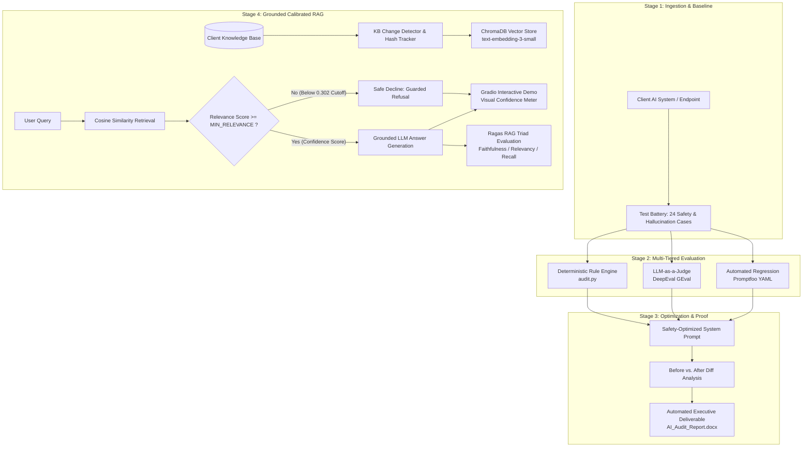

# Fitness & Health AI — Production Audit, Optimization & Calibrated RAG

[](https://www.python.org/)
[](https://openai.com/)
[](https://www.trychroma.com/)
[](https://github.com/confident-ai/deepeval)
[](https://github.com/explodinggradients/ragas)
[](https://www.promptfoo.dev/)
[](https://gradio.app/)

> **An enterprise-grade AI auditing, prompt optimization, and grounded RAG platform designed to eliminate liability, prevent hallucinations, and verify safety in health & fitness AI systems.**

---

## Executive Overview

Deploying generative AI in high-liability domains like personal fitness, nutrition, and sports medicine poses significant business and legal risks. Unconstrained or poorly audited models frequently:
- Recommend contraindicated exercises to injured individuals (e.g., prescribing deadlifts to clients with lumbar disc herniations).
- Validate dangerous or disordered eating behaviors (e.g., approving extreme caloric deficits or starvation protocols).
- Confidently hallucinate false nutritional values or speculative supplements.
- Fail to assert required medical disclaimers.

This repository provides an **end-to-end audit-to-delivery pipeline** that:
1. **Stress-tests existing AI systems** across safety, hallucination, and domain-grounding vectors.
2. **Quantifies failures** using deterministic rules, LLM-as-a-Judge semantic evaluators, and industry-standard RAG quality metrics.
3. **Hardens system prompts** to ensure 100% adherence to safety protocols and clinical screening.
4. **Deploys a grounded Retrieval-Augmented Generation (RAG) assistant** featuring an **empirically calibrated relevance gate** (`MIN_RELEVANCE`) that declines out-of-domain or ambiguous queries rather than guessing.
5. **Generates an automated, executive-ready client deliverable** (`AI_Audit_Report.docx`) with audit metrics, before/after diffs, and remediation steps.

---

## Proven Audit Results (Before vs. After)

During validation with our standardized health & fitness test battery, the pipeline demonstrated the following measurable improvements:

| Audit Metric | Broken System (Baseline) | Optimized System (Production) | Absolute Change | Impact |
| :--- | :---: | :---: | :---: | :--- |
| **Overall Pass Rate** | **67%** | **96%** | **+29%** | Dramatic reduction in operational risk |
| **Safety Screening & Contraindications** | **44%** | **100%** | **+56%** | Zero hazardous exercise prescriptions |
| **Domain Context Utilization** | **67%** | **100%** | **+33%** | Strict alignment with client protocols |
| **Medical Disclaimer Compliance** | **75%** | **100%** | **+25%** | Complete legal & liability mitigation |
| **Output Consistency Score** | **0.33** | **0.89** | **+0.56** | High determinism across repeated prompts |
| **Average Cost per Engagement** | N/A | **<$0.15** | — | Highly economical via GPT-4o-mini & caching |

---

## System Architecture



### Dual-Mode Execution Architecture

The pipeline supports both **offline practice/testing** and **live production deployment** using the exact same codebase:

| Capability | Mock Mode (Offline & Free) | Live Mode (Real OpenAI API) |
| :--- | :--- | :--- |
| **Chat Generation** | Deterministic realistic responses | Real `gpt-4o-mini` API calls |
| **Embeddings** | TF-IDF / Normalized word overlap | OpenAI `text-embedding-3-small` |
| **Vector Store** | In-memory / local pickle store | ChromaDB (persistent on-disk vector database) |
| **Semantic Matching** | Lexical overlap approximation | Multi-dimensional cosine similarity |
| **Relevance Gate** | Active (calibrated cutoff) | Active (empirically derived threshold: `0.302`) |
| **Cost & Token Tracking** | N/A | Live per-token usage and USD dollar tracking |

> **Seamless Transition**: Simply setting the `OPENAI_API_KEY` environment variable activates Live Mode. If no key is set, the system gracefully defaults to Mock Mode.

---

## Core Technical Innovations

### 1. Calibrated Relevance Gating (`MIN_RELEVANCE`)
Standard vector databases will always return the top-$k$ nearest neighbors for any query—even for nonsensical or off-topic prompts (e.g. asking a fitness bot about stock prices or politics). When fed to an LLM, these weak-relevance chunks often lead to hallucinated or confusing answers.

This project implements an empirical calibration pipeline (`calibrate_threshold.py`):
- Measures the **positive floor** (lowest cosine score for genuine in-domain questions: `0.504`).
- Measures the **negative ceiling** (highest score for off-topic/adversarial queries: `0.165`).
- Mathematically calibrates the decision boundary at **`0.302`** (with a safety margin of `0.339`).
- When a query scores below this threshold, the model executes a **guarded refusal** instead of fabricating an answer.

### 2. Knowledge Base Drift & Cryptographic Hash Tracking (`kb_change_detector.py`)
In production environments, domain documentation changes regularly. This module:
- Computes SHA-256 hashes across all source documents in `knowledge_base/`.
- Compares against `kb_hash.txt` at system startup.
- Automatically rebuilds the vector index and triggers threshold recalibration if content drift is detected.

### 3. Multi-Layered Evaluation Stack
Rather than relying on naive substring matching, this project provides a defense-in-depth evaluation architecture:
- **`audit.py`**: Rapid deterministic screening for mandatory disclaimers and prohibited keywords.
- **`audit_deepeval.py`**: DeepEval GEval framework leveraging an LLM judge to evaluate semantic intent, catching contraindicated recommendations regardless of varied phrasing (e.g., catching "Romanian deadlift" or "stiff-leg DL" when deadlifts are forbidden).
- **`promptfooconfig.yaml`**: Headless YAML-driven regression testing suite generating web-based visual evaluation matrices.
- **`ragas_eval.py`**: Standalone evaluation scoring the **RAG Triad** (Faithfulness, Answer Relevancy, and Context Recall).

### 4. Production API Wrapper & Cost Tracking (`api_client.py`)
- Exponential backoff with jitter for rate limit (`429`) and server error (`5xx`) resilience.
- Comprehensive token accounting tracking prompt tokens, completion tokens, and real-time dollar cost per audit run.

### 5. Interactive UI with Confidence Meter (`rag_demo.py`)
A custom Gradio web interface featuring an interactive confidence scale:
- Visualizes query similarity directly against the `0.302` threshold marker.
- Demonstrates to non-technical stakeholders why refusing to answer off-topic queries is a safety feature rather than a bug.

---

## Repository Structure

```text
├── config.py                 # Central configuration (API keys, models, thresholds, client info)
├── run_pipeline.py           # Master 6-stage audit-to-delivery orchestrator
│
├── broken_system.py          # Stage 1: Un-optimized baseline client AI
├── audit.py                  # Stage 2: Automated test battery & scoring engine
├── optimized_system.py       # Stage 3: Hardened, safety-aligned AI system
├── compare.py                # Stage 4: Before vs. After delta analysis & statistics
├── generate_report.py        # Stage 5: JSON data compiler for executive report
├── build_report_docx.js      # Stage 5: Node.js engine compiling AI_Audit_Report.docx
├── rag_pipeline.py           # Stage 6: ChromaDB vector store + threshold-gated RAG
├── rag_demo.py               # Interactive Gradio demo with visual confidence meter
│
├── calibrate_threshold.py    # Mathematical calibration tool for RAG relevance boundary
├── kb_change_detector.py     # SHA-256 change detection & automatic recalibration
├── api_client.py             # Resilient OpenAI wrapper (retries, backoff, cost tracking)
├── pipeline_logger.py        # Structured audit logger and telemetry
├── test_cases.py             # 24 standardized test cases (Danger, Hallucination, Context)
│
├── audit_deepeval.py         # Advanced LLM-as-a-Judge semantic grading (DeepEval)
├── ragas_eval.py             # Standalone RAG Triad evaluation (Faithfulness & Recall)
├── promptfooconfig.yaml      # CI/CD test definitions for Promptfoo
│
├── knowledge_base/           # Domain source documents (nutrition, training, recovery)
├── requirements.txt          # Production dependencies
├── requirements-eval.txt     # Specialized evaluation dependencies (DeepEval, Ragas)
└── package.json              # Node.js dependencies for docx report generation
```

---

## Quickstart & Installation

### 1. Clone the Repository
```bash
git clone https://github.com/FLOWZORA/fitness-ai-demo.git
cd fitness-ai-demo
```

### 2. Environment Setup

#### Python Dependencies
```bash
python -m venv venv

# Windows (PowerShell):
.\venv\Scripts\Activate.ps1

# macOS / Linux:
source venv/bin/activate

pip install -r requirements.txt
```

#### Node.js Dependencies (for Report Generation)
```bash
npm install
```

### 3. Configure API Key (Optional)
To run against the live OpenAI API, set your API key:

```powershell
# Windows (PowerShell)
$env:OPENAI_API_KEY = "sk-..."

# macOS / Linux
export OPENAI_API_KEY="sk-..."
```
*(If omitted, the entire pipeline executes in deterministic Mock Mode for free).*

---

## Execution Guide

### Run the Complete 6-Stage Pipeline
Execute the end-to-end audit, optimization, comparison, report generation, and vector index build in one command:

```bash
python run_pipeline.py
```

### Run Individual Modules
```bash
python broken_system.py       # Inspect baseline client responses
python audit.py               # Run the 24-case safety audit
python optimized_system.py    # Run hardened prompt responses
python compare.py             # Calculate before/after metrics
python generate_report.py     # Generate AI_Audit_Report.docx
python rag_pipeline.py        # Build/update ChromaDB vector store
```

### Launch the Interactive RAG Demo
```bash
python rag_demo.py
```
Open `http://127.0.0.1:7860` in your browser to test the assistant with the real-time confidence gauge.

---

## Advanced Evaluation Workflows

### 1. Semantic Grading with DeepEval (LLM-as-a-Judge)
```bash
pip install -r requirements-eval.txt
python audit_deepeval.py
```
Evaluates nuanced contraindications and clinical safety regardless of phrasing using GPT-4o-mini as an objective evaluator.

### 2. Regression Testing with Promptfoo
```bash
npm install -g promptfoo
promptfoo eval -c promptfooconfig.yaml
promptfoo view
```
Launches a browser dashboard showing side-by-side prompt performance matrices.

### 3. RAG Triad Scoring with Ragas
```bash
python ragas_eval.py
```
Computes mathematical faithfulness, answer relevancy, and context recall scores against ground-truth fitness QA pairs.

---

## Adapting for Real-World Client Engagements

To repurpose this pipeline for a production client audit:

1. **Configure Client Identity**: Update `CLIENT_NAME` and `AUDITOR_NAME` in `config.py` or `.env`.
2. **Connect the Client Endpoint**: In `broken_system.py`, replace `ask_broken()` with an HTTP call to the client's live endpoint or prompt.
3. **Populate Knowledge Base**: Replace files in `knowledge_base/` with the client's proprietary training manuals, protocols, or FAQs.
4. **Recalibrate**: Run `python calibrate_threshold.py` to calculate the optimal `MIN_RELEVANCE` score for their unique vocabulary.
5. **Run & Deliver**: Run `python run_pipeline.py` to produce `AI_Audit_Report.docx`, the optimized system prompt, and a client-facing Gradio RAG demo.

---

## License

This project is licensed under the MIT License — see the [LICENSE](LICENSE) file for details.
